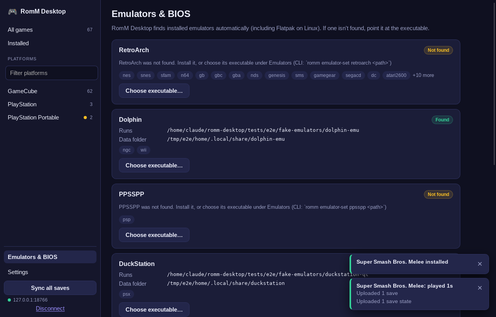

# RomM Desktop

A Windows + Debian/Linux desktop client for [RomM](https://github.com/rommapp/romm), modelled on [Argosy](https://github.com/rommapp/argosy-launcher) for Android: browse your library, download games and BIOS files, launch them in your emulators, and keep **saves and save states** in sync with your server.


| After a play session | Emulators | Settings |
|---|---|---|
|  |  |  |

## What it does

- **Library**: platforms, search, infinite-scroll grid with cover art, an *Installed* view that works offline.
- **Install / uninstall** with a progress bar. Multi-disc games are extracted and pointed at their `.m3u`.
- **Play** = pull saves and states → launch the emulator → work out which files changed → push saves, states and playtime. If you're offline it still launches, and changes upload next time.
- **Save states** are synced per file with your own baseline (RomM exposes no hash for states), with a size cap and a clear status per state (*in sync / newer here / newer on server / conflict …*).
- **Conflicts** never lose data. Default "keep both": your version is archived on the server, the server's is used, and what's replaced locally is copied to a backups folder first.
- **Emulators**: RetroArch (incl. Nintendo DS via its melonDS core), Dolphin, PPSSPP, DuckStation (PS1), PCSX2 (PS2), Azahar (3DS), xemu (original Xbox, launch only: see below); auto-detected on PATH, standard Windows locations and Flatpak, or point at the executable. BIOS files install into the right folder, MD5-verified. Under **Emulators & BIOS → Which emulator plays what**, each system only offers what can actually play it: standalone emulators that list the system, plus the RetroArch cores that run it (Game Boy offers Gambatte, mGBA, SameBoy, Gearboy, TGB Dual and VBA-M; 3DS offers Azahar; nothing for a system with no emulator yet). Choices whose emulator or core isn't installed are flagged, not hidden. Anything that can't play a system is refused when saved.
- **Game controller navigation**: browse, install, play and change settings without touching a keyboard or mouse (see below).

## Game controller

Plug in a controller and press any button. Xbox, PlayStation and Switch pads work through the standard browser Gamepad API (WebKitGTK/libmanette on Linux, WebView2 on Windows), so there is nothing to install. Button hints use the glyphs of the controller you're holding.

| Control | Action |
|---|---|
| D-pad / left stick | Move focus (spatial: Down from a card goes to the card below) |
| A (✕) | Select; on a text field it opens an **on-screen keyboard** |
| B (○) | Back / close the panel or keyboard |
| Start (Menu) | Play the focused game (Install if it isn't installed, inside the panel) |
| LB / RB | Previous / next platform |
| LT / RT | Page up / down (focus follows) |
| Y (△) | Search |
| X (□) | Dismiss notifications (in the keyboard: delete) |
| View (Select) | Switch between the menu and the games |
| Right stick | Scroll |

Safety rules: input is ignored while the window is in the background or an emulator is running, and after a game exits a button that's still held is ignored until released, so the press that quits your game can't trigger anything. Mouse or keyboard use hands control straight back; Settings has an off switch.


| Panel | On-screen keyboard |
|---|---|
|  |  |

## Layout

```
crates/romm-core   UI-free library: API client, emulator profiles, save + state sync, installer
crates/romm-cli    `romm` command (same core)
app/               Tauri 2 desktop app: React + TypeScript UI (app/src), Rust backend (app/src-tauri)
tests/smoke        scripted CLI runs against a fake server (two "devices")
tests/e2e          drives the real app through WebDriver under Xvfb (mouse/keyboard run + a simulated-controller run)
```

## Build

Rust 1.85+, Node 20+.

```bash
# Debian / Ubuntu: Tauri's system libraries
sudo apt install build-essential libwebkit2gtk-4.1-dev libgtk-3-dev libsoup-3.0-dev \
                 libjavascriptcoregtk-4.1-dev librsvg2-dev libxdo-dev

cd app && npm install
npm run tauri dev                 # development, hot reload
npm run tauri build               # installers: .deb / .AppImage (Linux), .msi / .exe (Windows)
```
On Windows install Rust (MSVC toolchain) and Node; WebView2 is handled by the installer. The CLI builds with plain `cargo build --release -p romm-cli`.

A GitHub Actions workflow (`.github/workflows/build.yml`) builds both installers. **It hasn't been run yet.**

## First run

In RomM: **Profile → Client API Tokens**, create a token with scopes `me.read platforms.read roms.read firmware.read assets.read assets.write devices.read devices.write`, press **Pair**, and enter the 8-digit code in the app.

## How saves and states sync

| | Saves | Save states |
|---|---|---|
| Protocol | RomM's device-sync protocol (negotiate → apply → complete) | Plain `/api/states` calls; RomM's sync protocol doesn't cover states |
| RetroArch | `<rom>.srm`, uploaded as-is | `<rom>.state`, `.state1…`, `.state.auto` (+ `.png` thumbnail attached) |
| Dolphin / PPSSPP / DuckStation / PCSX2 / Azahar | shared memory-card / NAND / emulated-SD-card folders, diffed around the session and zipped | one file per slot in the emulator's state folder, synced individually |
| Change detection | MD5 vs. server record, per-device baseline held by RomM | local MD5 (stat-cached) + server `updated_at`/size vs. our own baseline; a file seen on both sides with no baseline is verified by download once |

**xemu is launch only.** Its saves and snapshots live inside the virtual hard disk image (`xbox_hdd.qcow2`), not in separate files, so there is nothing safe to sync per game; syncing the whole image would make any two-device conflict a whole-disk conflict. Its BIOS and HDD image are set inside xemu itself, so there is no BIOS install either. Original Xbox disc images must be in XISO format (xemu's docs cover converting Redump ISOs with `extract-xiso`). Xbox 360 (`xbox360`) isn't mapped to any emulator.

Deletions never propagate. A state you delete locally stays deleted unless the server's copy changes; one removed from the server isn't re-uploaded unless you changed it.

Emulator profiles are TOML in `crates/romm-core/src/profiles/`: detection, launch flags, per-OS/Flatpak/portable data folders, save and state rules. Adding an emulator is a new file, and its `platforms` list is what decides which systems offer it. RetroArch cores are the exception: they're listed per system in `CORES` in `crates/romm-core/src/retroarch.rs` (first entry is the default that "Automatic" uses).

## Tests

```bash
cargo test --workspace --lib --tests   # 113 tests: 106 in romm-core (mock RomM server), 7 for the app's command layer
cd app && npm test                      # 46 UI tests: formatting, controller input/timing, spatial focus, on-screen keyboard, emulator picker
tests/e2e/run.sh                        # 36 checks driving the real app (needs xvfb + webkit2gtk-driver, debug build)
DRIVER=drive_pad.py tests/e2e/run.sh    # 50 checks driving the real app with a simulated controller
DRIVER=drive_choices.py tests/e2e/run.sh # 26 checks on per-system emulator choices (what's offered, persistence, refusals)
tests/smoke/smoke.sh && tests/smoke/states_smoke.sh   # CLI, two simulated devices
```

## What has and hasn't been verified

**Verified**
- Core logic and CLI: unit and integration tests, plus scripted two-device runs of the real binary.
- UI: the real Linux app (WebKitGTK, software-rendered under Xvfb) driven through login errors, pairing, library paging and search, cover art, install with progress, play → save + state upload, installed list, emulator detection, BIOS install, settings persistence, sync all, disconnect. The screenshots above come from that run.
- Controller navigation: the real app driven end to end with a **simulated** controller: on-screen keyboard, grid/sidebar/panel navigation, both sticks, paging, infinite-scroll loading, platform switching, install, play, Start-to-play, ignoring input while a game runs, dropdowns and number fields, saving settings, opting out. It surfaced and fixed four real bugs (focus-lift mis-navigation, Down jumping to the menu, focus parking on the search box, and a library "No games" flash).
- Windows path logic is unit-tested, and the core + CLI have been built on Windows.

**Not verified, so please test**
- Against a **real RomM server**. Everything is written from RomM's docs and source and tested against a fake server I wrote. The device-sync protocol is still changing, so pin a minimum server version. Cover art assumes `/assets/…` accepts the bearer token; if not, the grid shows placeholders.
- With **real emulators**. Launch flags and save/state folders come from each project's documented behaviour. Likeliest to need tweaks: Wii NAND roots, DuckStation/PCSX2/PPSSPP state folder names, PCSX2 state file naming. The Azahar and xemu profiles were checked against those projects' source code and docs but never run against the real emulators; for Azahar, the Windows install locations are guesses and the save roots assume the default all-zero `sdmc` id folders (a console-imported `movable.sed` changes them). Azahar needs your console's keys in `sysdata/keys.txt` to play encrypted dumps (older Citra guides call it `aes_keys.txt`).
- The **Windows app** (WebView2) and the **installers**: only the Linux build was run.
- **A real controller.** The test injects a fake `navigator.getGamepads()` into the real webview, so the app's polling, mapping, focus and keyboard are exercised, but not the OS → WebKit/WebView2 hop (there is no virtual input device in the sandbox). WebKitGTK is confirmed to link libmanette, its gamepad backend. First thing to try: plug in your pad and press a button; a "Controller connected" notice should appear. Controller types are told apart by name, so an unusual pad may show Xbox-style labels.
- **Native file pickers** (the Browse… buttons) can't be automated, and a controller can't drive the OS file dialog. Use the keyboard for those.
- Flatpak launches: the sandbox needs access to your ROM folder.

**Known limits**
- Keyboard shortcuts are minimal (`/` focuses search, `Esc` closes the panel).
- Nintendo pads are labelled as printed (their A/B are swapped relative to Xbox) but "accept" is always the bottom button; there is no swap option yet.
- Shared-folder saves are this app's own zip format, so they don't interoperate with Argosy's. RetroArch states only interoperate when both devices use the same core and version.
- No in-app conflict-resolution dialog yet. "Leave it alone" reports conflicts without acting; the other policies resolve them automatically.
- The token lives in a 0600 file, not the OS keychain.
- RetroArch saves are `.srm` only (no `.rtc`).

Licence: GPL-3.0-or-later (add the LICENSE text before publishing).
