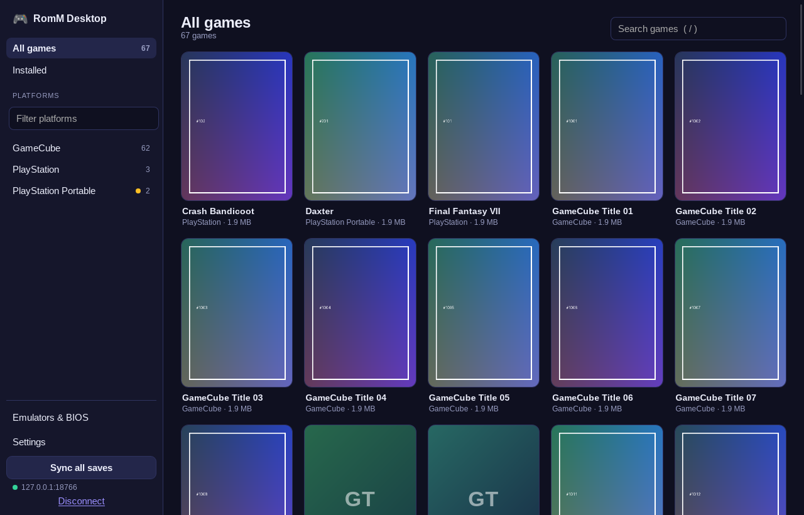
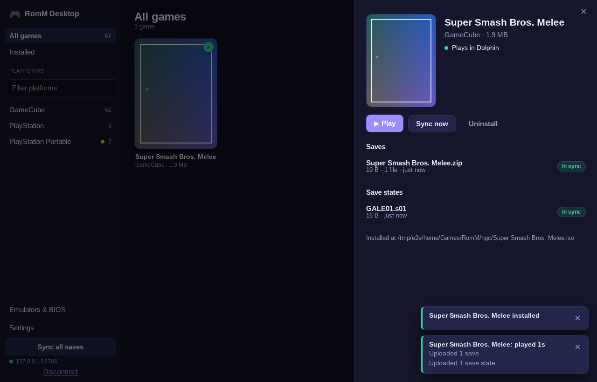
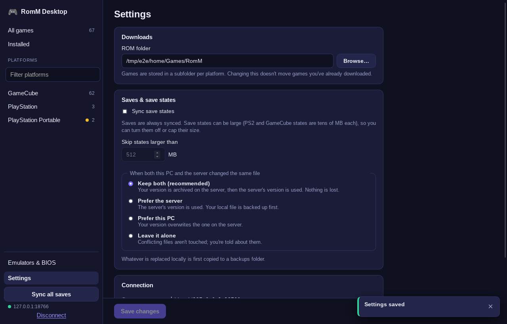
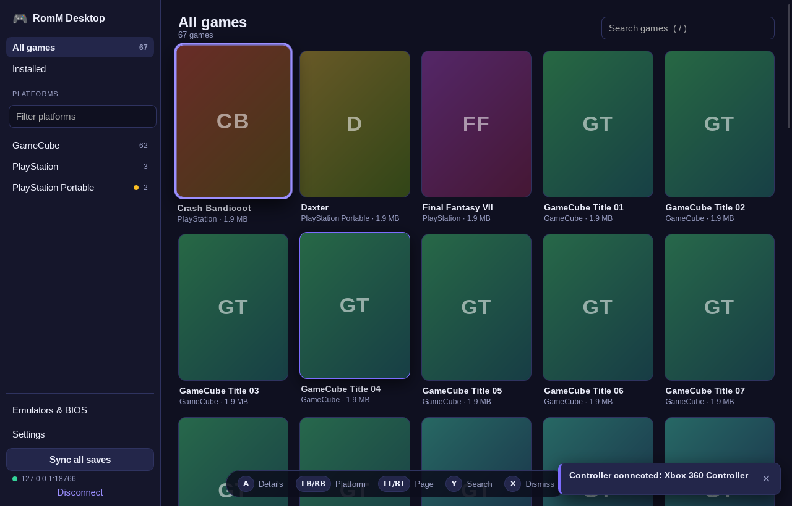
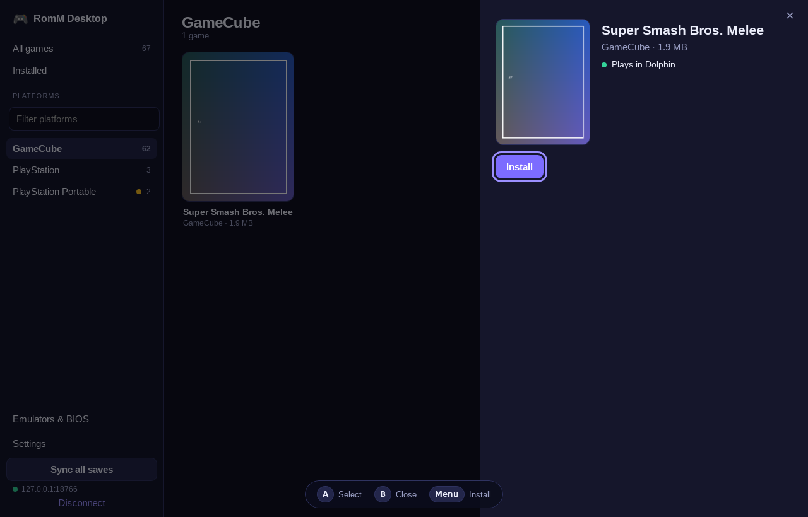
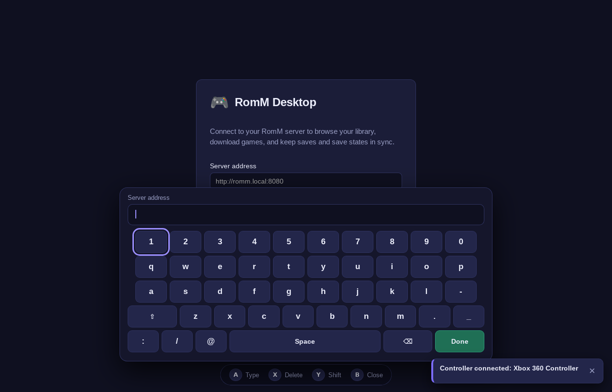

# RomM Desktop

A Windows + Linux desktop client for [RomM](https://github.com/rommapp/romm), modelled on [Argosy](https://github.com/rommapp/argosy-launcher) for Android. All vibes ⭐🎉🚀

| Library | After a play session | Settings |
|---|---|---|
|  |  |  |

## What it does

- **Library**: platforms, search, a scrolling grid with cover art, an *Installed* view that works offline.
- **Install / uninstall** ROMs locally.
- **Play**: pull saves and states → launch the emulator → work out which files changed → push saves, states and playtime.
- **Conflicts**: never lose data. Default "keep both": your version is archived on the server, the server's is used, and what's replaced locally is copied to a backups folder first.
- **Emulators**: RetroArch, DuckStation (PS1), Dolphin, PPSSPP, PCSX2 (PS2), Azahar (3DS), xemu (original Xbox, see below). Auto-detected via PATH, standard Windows locations and Flatpak, or manually locate the executable. BIOS files install into known folders.
- **RetroAchievements**: each game's achievements with what you've earned, progress and points, read from your RomM server.
- **Controller support**: browse, install, play and change settings without touching a keyboard or mouse.

## Game controller

Plug in a controller and press any button. Xbox, PlayStation and Switch pads work through the standard browser Gamepad API (WebKitGTK/libmanette on Linux, WebView2 on Windows), so there is nothing to install. Button hints use the glyphs of the controller you're holding.

| Control | Action |
|---|---|
| D-pad / left stick | Move focus (spatial: Down from a card goes to the card below) |
| A (✕) | Select; on a text field it opens an **on-screen keyboard** |
| B (○) | Back / close the panel or keyboard |
| Start (Menu) | Play the focused game (Install if it isn't installed, inside the panel) |
| LB / RB | Previous / next platform |
| LT / RT | Page up / down (focus follows) |
| Y (△) | Search |
| X (□) | Dismiss notifications (in the keyboard: delete) |
| View (Select) | Switch between the menu and the games |
| Right stick | Scroll |

Safety rules: input is ignored while the window is in the background or an emulator is running, and after a game exits a button that's still held is ignored until released, so the press that quits your game can't trigger anything. Mouse or keyboard use hands control straight back; Settings has an off switch.



| Panel | On-screen keyboard |
|---|---|
|  |  |

## Layout

```
crates/romm-core   UI-free library: API client, emulator profiles, save + state sync, installer
crates/romm-cli    `romm` command (same core)
app/               Tauri 2 desktop app: React + TypeScript UI (app/src), Rust backend (app/src-tauri)
tests/smoke        scripted CLI runs against a fake server (two "devices")
tests/e2e          drives the real app through WebDriver under Xvfb (mouse/keyboard run + a simulated-controller run)
```

## Build

Rust 1.90+ (the locked Tauri needs it; the core and CLI crates alone need 1.88), Node 20+.

```bash
# Debian / Ubuntu: Tauri's system libraries
sudo apt install build-essential libwebkit2gtk-4.1-dev libgtk-3-dev libsoup-3.0-dev \
                 libjavascriptcoregtk-4.1-dev librsvg2-dev libxdo-dev

cd app && npm install
npm run tauri dev                 # development, hot reload
npm run tauri build               # installers: .deb / .AppImage (Linux), .msi / .exe (Windows)
```
On Windows install Rust (MSVC toolchain) and Node; WebView2 is handled by the installer. The CLI builds with plain `cargo build --release -p romm-cli`.

A GitHub Actions workflow (`.github/workflows/build.yml`) builds both installers. **It hasn't been run yet.**

## First run

In RomM: **Profile → Client API Tokens**, create a token with scopes `me.read platforms.read roms.read firmware.read assets.read assets.write devices.read devices.write`, press **Pair**, and enter the 8-digit code in the app.

Optional: add `me.write` to refresh RetroAchievements progress from inside the app (see [RetroAchievements](#retroachievements)). It is deliberately not in the list above: besides refreshing RetroAchievements, it lets a token edit your RomM profile and manage API tokens.

## Games with several versions

A game that exists as several files on your server (USA / Europe / Japan, revisions, a translation) is **one card**, not one per file. This follows what RomM's web UI and [Argosy](https://github.com/rommapp/argosy-launcher) do.

- **Which one is shown is the server's choice.** The library is requested with RomM's `group_by_meta_id`, so RomM picks the representative: the copy you marked as default in RomM (*Set default*), else a full release over a pre-release, else the best by the server's region priority, else by file name. The app doesn't second-guess it and has no setting of its own for this; change it in RomM and press ↻.
- **Cards say when there's more.** A card with other versions carries an "N versions" badge, and counts everywhere (sidebar, header) are games, not files.
- **The panel has a Version dropdown** (also usable with a controller: left/right steps through it). It opens on the version you have installed, otherwise on the server's pick, which is marked *default*. Install, Play, Sync, saves, save states and achievements all act on the selected version.
- **Each version is its own ROM**, as in RomM and Argosy: its own install, its own saves and states. Installing Japan next to USA doesn't mix their saves. A game counts as installed when any version is. In the *Installed* list, two installed versions of one game show their tags (`USA`, `Japan · Rev 1`) to tell them apart.
- **Labels** come from the file name, the trailing `(USA) (Rev 1)` groups, because RomM sends nothing more about a sibling. Real releases are listed before pre-releases (`Beta`, `Proto`, `Demo`...), translations and hacks.

**Why the whole library is fetched.** Like Argosy, which syncs everything and browses locally, the app loads the grouped library (500 per page, no file lists, progress shown) and filters, searches and pages in memory. That makes the counts exact, platform switching and search instant, and a search finds a game through any of its versions (as RomM's does). The copy is reused for 10 minutes when you open a list from the top, never while you scroll, and **↻** next to the search box reloads it. If a reload fails, the previous copy stays in use.

## If the window goes dark

A web view that dies or stops painting leaves nothing on screen and nothing in any console, so the app keeps a small log of its own: `diagnostics/ui.log` (and `ui.log.1`, the one before it) in the app's data folder (`%APPDATA%\romm\romm-desktop\data` on Windows, `~/.local/share/romm-desktop` on Linux, `~/Library/Application Support/app.romm.romm-desktop` on macOS, or under `ROMM_DESKTOP_HOME`). It holds counts and timings only, never names or addresses, and is capped at about 512 KB.

- `app` lines come from the backend: startup (version, OS, **web view version**), the library loading, and a `WATCHDOG` line if the page stops reporting for 10 seconds while it is on screen, and another when it starts again.
- `page` lines come from the UI. `hb` is a report every two seconds: `heap` (JS memory), `nodes` (size of the page), `cards`, `imgs` (loaded/total), `scroll` (position), `lag` (how late its timer fired: a busy or hung page runs late), `vis`/`focus`, `pads` (controllers seen) and `hints` (controller hint bar shown). `error`, `rejection`, `csp blocked`, `longtask` and `visibility` lines say what it sounds like.

Reading it after a black screen: if the `hb` lines **keep coming** after the screen went dark, the page is alive and it is the painting (GPU, compositor) that failed. If they **stop** (look for `WATCHDOG`), the page hung or its process died, and the last `hb` shows what it was doing: `heap` or `nodes` climbing, `lag` growing, or nothing unusual.

On Windows the page runs in WebView2 (Chromium). To test whether the GPU path is involved, start the app from a terminal with `set WEBVIEW2_ADDITIONAL_BROWSER_ARGUMENTS=--disable-gpu` (cmd) or `$env:WEBVIEW2_ADDITIONAL_BROWSER_ARGUMENTS="--disable-gpu"` (PowerShell) first.

## How saves and states sync

| | Saves | Save states |
|---|---|---|
| Protocol | RomM's device-sync protocol (negotiate → apply → complete) | Plain `/api/states` calls; RomM's sync protocol doesn't cover states |
| RetroArch | `<rom>.srm`, uploaded as-is | `<rom>.state`, `.state1…`, `.state.auto` (+ `.png` thumbnail attached) |
| Dolphin / PPSSPP / DuckStation / PCSX2 / Azahar | shared memory-card / NAND / emulated-SD-card folders, diffed around the session and zipped | one file per slot in the emulator's state folder, synced individually |
| Change detection | MD5 vs. server record, per-device baseline held by RomM | local MD5 (stat-cached) + server `updated_at`/size vs. our own baseline; a file seen on both sides with no baseline is verified by download once |

**xemu is launch only.** Its saves and snapshots live inside the virtual hard disk image (`xbox_hdd.qcow2`), not in separate files, so there is nothing safe to sync per game; syncing the whole image would make any two-device conflict a whole-disk conflict. Its BIOS and HDD image are set inside xemu itself, so there is no BIOS install either. Original Xbox disc images must be in XISO format (xemu's docs cover converting Redump ISOs with `extract-xiso`). Xbox 360 (`xbox360`) isn't mapped to any emulator.

Deletions never propagate. A state you delete locally stays deleted unless the server's copy changes; one removed from the server isn't re-uploaded unless you changed it.

Emulator profiles are TOML in `crates/romm-core/src/profiles/`: detection, launch flags, per-OS/Flatpak/portable data folders, save and state rules. Adding an emulator is a new file, and its `platforms` list is what decides which systems offer it. RetroArch cores are the exception: they're listed per system in `CORES` in `crates/romm-core/src/retroarch.rs` (first entry is the default that "Automatic" uses).

## RetroAchievements

Open a game and its **Achievements** section shows the set, which ones you've earned (hardcore ones are marked), points, the highest award, and when you last earned one. Badges load as you scroll; long sets show the first few with a *Show all* button. A **search box** finds achievements by name or description (every word must match; accents and case are ignored), and a **Missable** toggle narrows the list to the ones RetroAchievements marks as missable, meaning they can be lost for good. It combines with *Earned / Locked*, so *Missable* + *Locked* is what you can still miss. The number on each button is how many you'd see if you chose it. *Missable* is greyed out for games where RetroAchievements marks none, and the search and the toggle also work before you've linked a username (to see what to watch out for before you play). Esc clears the search before it closes the panel. It also works offline, from the copy saved the last time the server answered.

This app only *displays* what RomM knows. It doesn't talk to retroachievements.org and doesn't touch the emulators, so for any of this to show up:

1. RomM needs a RetroAchievements API key and your game scanned and matched to a RetroAchievements game.
2. Your **RetroAchievements username** must be set in your RomM profile. Without it you still see the achievements, just not which are earned.
3. **Earning** them happens in the emulator: sign in to RetroAchievements inside RetroArch, DuckStation, PCSX2, PPSSPP or Dolphin. This app doesn't configure that.
4. RomM must have fetched your progress. It does so on a schedule only if the admin turned that on (daily at 04:00 by default), or when asked. The **Refresh** button asks, and needs the optional `me.write` scope. Without it Refresh explains what to do; refreshing from RomM's own profile page works too.

How it reads the data: the achievement list comes from `GET /api/roms/{id}` (`merged_ra_metadata`) and your progress from `GET /api/users/me` (`ra_progression`, scope `me.read`, which the token already has). RomM records what you've earned under each achievement's *badge name*, not its numeric id, so that's what the two are matched on. A few games reuse one badge for several achievements; then the number earned is right but which of the look-alikes is ticked is a best guess.

## Tests

```bash
cargo test --workspace --lib --tests   # 156 tests, all in romm-core (against a mock RomM server)
cd app && npm test                      # 160 UI tests: formatting, controller input/timing, spatial focus, on-screen keyboard, emulator picker, achievements panel, game versions, the whole app mounted against a fake backend (startup, loading, crashes), diagnostics reporting, achievement search and filtering
tests/e2e/run.sh                        # 36 checks driving the real app (needs xvfb + webkit2gtk-driver, debug build)
DRIVER=drive_pad.py tests/e2e/run.sh    # 50 checks driving the real app with a simulated controller
DRIVER=drive_choices.py tests/e2e/run.sh # 26 checks on per-system emulator choices (what's offered, persistence, refusals)
DRIVER=drive_versions.py tests/e2e/run.sh # 30 checks on games with several versions (written, not yet run: see below)
tests/smoke/smoke.sh && tests/smoke/states_smoke.sh   # CLI, two simulated devices
```

## What has and hasn't been verified

**Verified**
- Games with several versions: the version, search, count and grouping logic (unit tests), the paged fetch against a mock server (grouped, no files, one count request, duplicates dropped), the card badge and the dropdown's contents and preselection (rendered components), and the real fetch-and-label code against the e2e fake server. The e2e journey `drive_versions.py` is written but **has not been run**; the app isn't built in the environment this was written in. The Tauri crate type-checks.
- Core logic and CLI: unit and integration tests, plus scripted two-device runs of the real binary.
- UI: the real Linux app (WebKitGTK, software-rendered under Xvfb) driven through login errors, pairing, library paging and search, cover art, install with progress, play → save + state upload, installed list, emulator detection, BIOS install, settings persistence, sync all, disconnect. The screenshots above come from that run.
- Controller navigation: the real app driven end to end with a **simulated** controller: on-screen keyboard, grid/sidebar/panel navigation, both sticks, paging, infinite-scroll loading, platform switching, install, play, Start-to-play, ignoring input while a game runs, dropdowns and number fields, saving settings, opting out. It surfaced and fixed four real bugs (focus-lift mis-navigation, Down jumping to the menu, focus parking on the search box, and a library "No games" flash).
- RetroAchievements: matching, offline copy and refresh errors against a fake server shaped like RomM's responses (including its badge-name quirk), and the panel in the real app, with and without the `me.write` scope.
- Windows path logic is unit-tested, and the core + CLI have been built on Windows.

**Not verified, so please test**
- Against a **real RomM server**. Everything is written from RomM's docs and source and tested against a fake server I wrote. The device-sync protocol is still changing, so pin a minimum server version. Cover art assumes `/assets/…` accepts the bearer token; if not, the grid shows placeholders.
- With **real emulators**. Launch flags and save/state folders come from each project's documented behaviour. Likeliest to need tweaks: Wii NAND roots, DuckStation/PCSX2/PPSSPP state folder names, PCSX2 state file naming. The Azahar and xemu profiles were checked against those projects' source code and docs but never run against the real emulators; for Azahar, the Windows install locations are guesses and the save roots assume the default all-zero `sdmc` id folders (a console-imported `movable.sed` changes them). Azahar needs your console's keys in `sysdata/keys.txt` to play encrypted dumps (older Citra guides call it `aes_keys.txt`).
- **RetroAchievements against a real RomM** with a RetroAchievements key and a linked account. The response shapes come from RomM's source, not a live server. A successful Refresh (a token with `me.write`) is covered by core tests only, not in the real app.
- The **Windows app** (WebView2) and the **installers**: only the Linux build was run.
- **A real controller.** The test injects a fake `navigator.getGamepads()` into the real webview, so the app's polling, mapping, focus and keyboard are exercised, but not the OS → WebKit/WebView2 hop (there is no virtual input device in the sandbox). WebKitGTK is confirmed to link libmanette, its gamepad backend. First thing to try: plug in your pad and press a button; a "Controller connected" notice should appear. Controller types are told apart by name, so an unusual pad may show Xbox-style labels.
- **Native file pickers** (the Browse… buttons) can't be automated, and a controller can't drive the OS file dialog. Use the keyboard for those.
- Flatpak launches: the sandbox needs access to your ROM folder.

**Known limits**
- Versions: the whole library is held in memory, so a very large library takes a moment to load the first time (progress is shown) and changes made on the server show up after ↻ or 10 minutes. The Installed list works offline and therefore shows only what is installed, with no dropdown for versions you haven't. `romm games` (CLI) lists every file, not one per game. RomM links "siblings" by any shared provider id, so now and then it chains in an unrelated game (Argosy documents HeartGold/SoulSilver); such a game appears in the dropdown, with its full file name when its label would clash. The version labels are read from file names; a file with no tags is labelled by its whole name. The search is local, over names and file names, and doesn't use RomM's alternative titles.
- Keyboard shortcuts are minimal (`/` focuses search, `Esc` closes the panel).
- Nintendo pads are labelled as printed (their A/B are swapped relative to Xbox) but "accept" is always the bottom button; there is no swap option yet.
- Shared-folder saves are this app's own zip format, so they don't interoperate with Argosy's. RetroArch states only interoperate when both devices use the same core and version.
- No in-app conflict-resolution dialog yet. "Leave it alone" reports conflicts without acting; the other policies resolve them automatically.
- The token lives in a 0600 file, not the OS keychain.
- RetroArch saves are `.srm` only (no `.rtc`).

License: GPL-3.0-or-later
